# Invoice Extraction → Google Sheets (n8n)

Automated accounts-payable intake for small accounting and bookkeeping firms.
Drop a PDF invoice into a Google Drive folder and, with no manual data entry, the workflow:

1. **Skips duplicates**: a file or invoice that is already in the log is never processed twice
2. **Reads** the invoice with an LLM (Google Gemini) using a strict JSON response schema
3. **Validates** the result with deterministic rules: required fields, YYYY-MM-DD dates, subtotal + tax = total
4. **Logs** one row per invoice to a Google Sheet (audit trail)
5. **Renames** the PDF to a standard convention (`YYYY-MM_Vendor_INVOICE#.pdf`) and **moves** it to a `Processed` folder
6. **Emails** a person only when an invoice is flagged *Needs Review*, or when the AI could not read it at all

> Built by **Chris Roberts**, Roberts & Roberts Automation.
> Staff accountant and automation developer, which is why every AI result goes through accountant-grade validation before it touches the books.

---

## Architecture

```mermaid
flowchart LR
    A["Google Drive Trigger<br/>polls Inbox every minute"] --> CFG["Config<br/>per-client settings, prompt, schema"]
    B["Reprocess Inbox<br/>manual backfill"] --> B2[List Inbox PDFs] --> CFG
    CFG --> C{"Is PDF?"}
    C -- no --> NP["Log Non-PDF<br/>Skipped - Not a PDF"]
    C -- yes --> R["Read Invoice Log<br/>once per run"] --> FID{"New file ID?"}
    FID -- no --> S1[Skip: File Already Logged]
    FID -- yes --> D[Download PDF] --> E[PDF to Base64]
    E --> F[Gemini 3.5 Flash Lite]
    F -- "error / empty" --> G[Fallback: Gemini 3.1 Flash Lite]
    G -- "error / empty" --> H[Fallback: Gemini 3.7 Flash]
    H -- "error / empty" --> FA["Email Failure Alert<br/>file stays in Inbox"]
    F & G & H -- content --> I["Parse AI Response<br/>never throws"]
    I --> J[Validate Invoice] --> DUP{"Duplicate vendor + invoice #?"}
    DUP -- yes --> S2[Skip: Duplicate Invoice]
    DUP -- no --> K[Log to Invoice Log] --> L[Rename PDF] --> MV[Move to Processed] --> NR{"Needs Review?"}
    NR -- yes --> M[Email Needs Review]
    NR -- no --> OK["OK: logged only<br/>(daily digest: future)"]
```



| Step | Purpose |
|---|---|
| **Google Drive Trigger** | Polls the Inbox folder every minute for new files |
| **Reprocess Inbox (manual)** | Backfill path: processes PDFs already in the folder (also retries failed ones) |
| **Config** | One Set node holding every per-client setting: Processed folder, sheet ID, emails, time zone, the Gemini prompt and response schema |
| **Is PDF?** | Input validation: PDFs continue; anything else is logged as `Skipped - Not a PDF` |
| **Read Invoice Log / New file?** | Reads the log once per run and skips any file whose Drive file ID is already logged, *before* a Gemini call is spent |
| **Download / PDF to Base64** | Fetches the binary and encodes it for the API request |
| **Gemini extraction** | Structured extraction with a response schema; temperature 0. All 3 models use the same prompt and schema from Config |
| **Has Content? + fallback chain** | An HTTP error *or* an empty/blocked answer fails over to the next model; if all 3 fail, a failure alert is emailed |
| **Parse AI Response** | Turns the model's JSON into typed fields; records which model answered. Bad or empty JSON becomes a Needs Review item, never a crash |
| **Validate Invoice** | Rule-based checks; sets `OK` or `Needs Review` with reasons; processed date/time in America/New_York |
| **Check Duplicate Invoice** | Skips invoices whose normalized vendor + invoice # is already logged (or appeared earlier in the same run) |
| **Log / Rename / Move** | Audit trail, naming convention, Inbox cleanup |
| **Needs Review? / Email** | Only Needs Review invoices email immediately; OK invoices are just logged |

## Key design decisions

- **The AI extracts; code verifies.** Model output is never trusted blindly. Totals are reconciled
  in code (1-cent tolerance) and missing fields are flagged before anything reaches the ledger.
- **No guessing.** The prompt tells the model to return `null` for anything not printed on the
  document, so missing data is surfaced, never invented.
- **Model failover instead of retries.** Retrying an exhausted endpoint burns quota; failing over
  to a different model (with its own quota) does not.
- **Throttled to the rate limit.** One request every 5 seconds (12/min) stays under the free tier's
  15 requests per minute.
- **Backfill path.** A polling trigger only sees new files, so a manual trigger processes an existing backlog.
- **Idempotent.** Re-running the backfill, a re-uploaded scan, or a repeated test run never creates a second row,
  rename, or email. Dedupe keys: the Drive file ID, plus *normalized vendor + invoice #* when an invoice # exists
  (vendor lower-cased, punctuation and `&` normalized, trailing `Inc/LLC/Co/Corp/Ltd/...` dropped; invoice # upper-cased,
  non-alphanumerics and leading zeros dropped, so `55-0193` = `55 0193`). Invoices with no invoice # are only deduped by file ID.
- **Fail loudly, never silently.** A run that can't read an invoice emails an alert with the file name, ID, and error,
  and leaves the PDF in the Inbox so **Reprocess Inbox** can retry it.

## What changed in v1.3

- **Dedupe** before logging (Drive file ID before the AI call; vendor + invoice # after it). Duplicates are not logged, renamed, moved, or emailed.
- **Email only for Needs Review.** OK invoices are logged, renamed and moved with no email (a daily digest is on the roadmap).
- **Failure alert** when all 3 models fail, including a "successful" Gemini response with empty or blocked content (that now tries the next model first).
- **`JSON.parse` is guarded**: malformed AI output becomes a Needs Review row: *"AI response was not valid JSON (...). Enter this invoice manually"*. The file keeps its original name.
- **Dates in Eastern time**: Date Processed / Processed At use Luxon `DateTime.now().setZone('America/New_York')` (configurable in Config). v1.2 used UTC, so invoices processed in the evening (after 8 PM EDT / 7 PM EST) were dated the next day.
- **Processed folder**: after renaming, the PDF is moved to `YOUR_PROCESSED_FOLDER_ID`.
- **One Config node** with all per-client settings, and **one shared prompt + schema** referenced by all 3 Gemini nodes (was copied 3 times).
- **Stricter validation**: dates must be real `YYYY-MM-DD` dates; a total that can't be checked because subtotal or tax is missing is flagged; amounts sent back as text (`"1,236.00"`) are converted.
- **Non-PDFs are logged** as `Skipped - Not a PDF` instead of being dropped silently.
- **New sheet columns**: `Source File ID`, `Model Used`, `Due Date Note`, `Processed At`.

## Test results

Five fictitious invoices (in `test-data/invoices/`) cover the happy path and known edge cases. Expected values were read
from the PDFs with `pdftotext -layout`.

| Invoice | Scenario | Expected | v1.3 result |
|---|---|---|---|
| 01 Liberty Bell Office Supply | Clean | OK, no email | ✅ OK, logged, renamed `2026-09_LibertyBellOfficeSupply_INV10482.pdf`, moved, no email |
| 02 Schuylkill IT Services | Different layout, $0 tax | OK, no email | ✅ OK, logged, renamed `2026-09_SchuylkillITServicesLLC_SIT20260917.pdf`, moved, no email |
| 03 Fishtown Print & Copy | Total off by $10 | Needs Review | ✅ "Total mismatch: subtotal + tax = 911.60, invoice says 921.60", email |
| 04 Rittenhouse Cleaning | No invoice number | Needs Review | ✅ "Missing Invoice #", `..._NOINV.pdf`, email |
| 05 Delaware Valley Courier | "Due upon receipt" | Needs Review | ✅ "No due date (Due upon receipt)", email |

Edge cases (v1.3):

| Case | Expected | Result |
|---|---|---|
| Gemini returns empty `candidates` on all 3 models | Failure-alert email with file name, ID, reason; nothing logged | ✅ |
| Empty answer from the primary model only | Falls back to 3.1, logs `Model Used = Gemini 3.1 Flash Lite` | ✅ |
| Prompt blocked (`blockReason: SAFETY`) on all 3 | Failure alert naming SAFETY | ✅ |
| HTTP 429 on all 3 / on primary then empty on 3.1 | Failure alert with last error / OK via 3.7 | ✅ / ✅ |
| Malformed JSON from Gemini | No crash; Needs Review with a clear note; original file name kept | ✅ |
| JSON wrapped in ```` ```json ```` fences | Parsed normally | ✅ |
| Same Drive file processed again | Skipped before download (0 Gemini calls), no log/rename/move/email | ✅ |
| Re-uploaded copy, `Delaware Valley Courier LLC` / `55 0193` vs logged `Delaware Valley Courier` / `55-0193` | Skipped as duplicate | ✅ |
| Two copies in one backfill (incl. answered by different models) | One logged, one skipped | ✅ |
| Non-PDF (`image/jpeg`) | Logged as `Skipped - Not a PDF`, nothing else | ✅ |
| Date `09/15/2026` / `2026-02-30` | Needs Review, file month `UNDATED` | ✅ |
| Total present, tax missing | Needs Review "Cannot verify total: missing Tax" | ✅ |
| Run at 10:30 PM ET (02:30 UTC next day) | Date Processed `2026-10-08`, Processed At `2026-10-08 22:30:00 EDT` | ✅ |

**34 / 34 offline checks passed** (10 structural + 24 scenarios). Full table: [`tests/results.md`](tests/results.md).

### How it was tested (and what wasn't)

- **Offline simulator** (`cd tests && npm install && npm test`): structural checks (valid JSON, unique ids/names, every connection
  points to a real node, no orphans, every `$('Node')` reference is upstream, all Code nodes compile, prompt/schema defined once),
  then every scenario above runs the workflow's **real Code-node JavaScript, IF conditions, Config node and parameter expressions**
  through a small n8n stand-in (`tests/n8n-sim.js`) with Drive, Sheets, Gmail and Gemini mocked. The same suite run against v1.2
  fails 27 of 34 checks, so it does detect the old behavior.
- **Real n8n runtime** (`tests/real-n8n/run.sh`, n8n 2.42.5 CLI): the workflow imports cleanly (`n8n import:workflow`, re-export
  identical). A copy with the Google nodes swapped for same-named Code/Set nodes and the Gemini nodes pointed at a local mock
  server was executed end to end with 11 files in one backfill: 5 logged, 3 Needs Review emails, 1 failure alert, 1 file-ID skip,
  3 vendor + invoice # skips (including one answered by the fallback model in a separate branch run), 1 non-PDF logged, no errors.
- **Not tested end to end:** the real Google Drive Trigger, Drive download/rename/move, Sheets read/append, Gmail, and the real Gemini
  API (no live credentials). In particular: the Sheets read returning the header-named columns the dedupe expects, the Drive move
  call against a real folder, and Gemini's actual output on the PDFs (the sample results are mocked responses with the values
  printed on each PDF). Run **Reprocess Inbox** on the sample PDFs after connecting credentials to confirm.

Regenerate the samples with `python test-data/generate_test_invoices.py` (requires `reportlab`).

## Setup

1. **n8n.** Self-hosted (`npx n8n`) or n8n Cloud.
2. **Google Cloud project.** Enable the Drive, Sheets, and Gmail APIs. Create an OAuth client
   (Web application) with redirect URI `http://localhost:5678/rest/oauth2-credential/callback`.
3. **Gemini API key.** Free from [Google AI Studio](https://aistudio.google.com).
4. **Credentials in n8n.** Google Drive OAuth2, Google Sheets OAuth2, Gmail OAuth2, and Google Gemini (PaLM) API.
5. **Google Sheet** (first tab) with this header row. The last 4 columns are new in v1.3; add them to an existing v1.2 sheet:
   `Date Processed | Vendor | Invoice # | Invoice Date | Due Date | Subtotal | Tax | Total | File Name | Status | Notes | Source File ID | Model Used | Due Date Note | Processed At`
6. **Two Drive folders**: an Inbox and a `Processed` folder.
7. **Import** `workflow/invoice-pdf-to-sheet.json` into n8n, then replace the placeholders:
   - On **Google Drive Trigger** and **List Inbox PDFs** (these run before Config): `YOUR_INBOX_FOLDER_ID`, the Drive folder to watch
   - In the **Config** node:
     - `processedFolderId` = `YOUR_PROCESSED_FOLDER_ID`: where finished PDFs are moved
     - `invoiceLogSheetId` = `YOUR_INVOICE_LOG_SHEET_ID`: the Google Sheet ID
     - `notifyEmail` = `you@example.com`: who gets Needs Review emails
     - `alertEmail` = `you@example.com`: who gets "all models failed" alerts
     - `timezone` = `America/New_York`; `extractionPrompt` and `responseSchema` are shared by all 3 Gemini nodes
8. Select your credentials on each node, run **Reprocess Inbox** once to test, then **Publish**.

## Capacity (Gemini free tier)

| Model | Requests/min | Requests/day |
|---|---|---|
| Gemini 3.5 Flash Lite (primary) | 15 | 500 |
| Gemini 3.1 Flash Lite (fallback) | 15 | 500 |
| Gemini 3.7 Flash (fallback) | 5 | 20 |

That's roughly **1,000 invoices per day** at no cost, well above a small firm's volume. A paid key removes these limits.

## Roadmap

- [x] Duplicate detection (Drive file ID, plus vendor + invoice # already logged)
- [x] Move processed files to a `Processed` folder
- [x] Alert when all models fail for an invoice
- [ ] Daily digest email of OK invoices (OK invoices currently log without an email)
- [ ] Hosted deployment (n8n Cloud or a VPS) for 24/7 uptime

## Tech stack

n8n · Google Gemini API · Google Drive API · Google Sheets API · Gmail API · OAuth 2.0 · JavaScript (n8n Code nodes, Luxon) · Node.js (offline tests) · Python (test-data generator)
