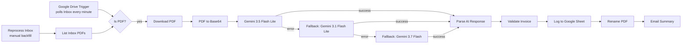

# Invoice Extraction → Google Sheets (n8n)

Automated accounts-payable intake for small accounting and bookkeeping firms.
Drop a PDF invoice into a Google Drive folder and, with no manual data entry, the workflow:

1. **Reads** the invoice with an LLM (Google Gemini) using a strict JSON response schema
2. **Validates** the result with deterministic rules: required fields, subtotal + tax = total
3. **Logs** one row per invoice to a Google Sheet (audit trail)
4. **Renames** the PDF to a standard convention: `YYYY-MM_Vendor_INVOICE#.pdf`
5. **Emails** a summary, so anything flagged *Needs Review* reaches a person

> Built by **Chris Roberts**, Roberts & Roberts Automation.
> Staff accountant and automation developer, which is why every AI result goes through accountant-grade validation before it touches the books.

---

## Architecture

| Step | Purpose |
|---|---|
| **Google Drive Trigger** | Polls the Inbox folder every minute for new files |
| **Reprocess Inbox (manual)** | Backfill path: processes PDFs already in the folder |
| **Is PDF?** | Input validation: only PDFs continue |
| **Download / PDF to Base64** | Fetches the binary and encodes it for the API request |
| **Gemini extraction** | Structured extraction with a response schema; temperature 0 |
| **Fallback chain** | On any error, fails over to the next model (one attempt each, separate quotas) |
| **Parse AI Response** | Turns the model's JSON into typed fields; records which model answered |
| **Validate Invoice** | Rule-based checks; sets `OK` or `Needs Review` with reasons |
| **Log / Rename / Email** | Audit trail, naming convention, human-in-the-loop notification |

## Key design decisions

- **The AI extracts; code verifies.** Model output is never trusted blindly. Totals are reconciled
  in code (1-cent tolerance) and missing fields are flagged before anything reaches the ledger.
- **No guessing.** The prompt tells the model to return `null` for anything not printed on the
  document, so missing data is surfaced, never invented.
- **Model failover instead of retries.** Retrying an exhausted endpoint burns quota; failing over
  to a different model (with its own quota) does not.
- **Throttled to the rate limit.** One request every 5 seconds (12/min) stays under the free tier's
  15 requests per minute.
- **Backfill path.** A polling trigger only sees new files, so a manual trigger processes an existing backlog.

## Test results

Five fictitious invoices (in `test-data/invoices/`) cover the happy path and known edge cases:

| Invoice | Scenario | Expected | Result |
|---|---|---|---|
| 01 Liberty Bell Office Supply | Clean | OK | ✅ OK |
| 02 Schuylkill IT Services | Different layout, $0 tax | OK | ✅ OK |
| 03 Fishtown Print & Copy | Total off by $10 | Needs Review | ✅ "Total mismatch: subtotal + tax = 911.60, invoice says 921.60" |
| 04 Rittenhouse Cleaning | No invoice number | Needs Review | ✅ "Missing Invoice #" |
| 05 Delaware Valley Courier | "Due upon receipt" | Needs Review | ✅ "No due date (Due upon receipt)" |

**5 / 5 passed.** Regenerate the samples with `python test-data/generate_test_invoices.py` (requires `reportlab`).

## Setup

1. **n8n.** Self-hosted (`npx n8n`) or n8n Cloud.
2. **Google Cloud project.** Enable the Drive, Sheets, and Gmail APIs. Create an OAuth client
   (Web application) with redirect URI `http://localhost:5678/rest/oauth2-credential/callback`.
3. **Gemini API key.** Free from [Google AI Studio](https://aistudio.google.com).
4. **Credentials in n8n.** Google Drive OAuth2, Google Sheets OAuth2, Gmail OAuth2, and Google Gemini (PaLM) API.
5. **Google Sheet** with this header row:
   `Date Processed | Vendor | Invoice # | Invoice Date | Due Date | Subtotal | Tax | Total | File Name | Status | Notes`
6. **Import** `workflow/invoice-pdf-to-sheet.json` into n8n, then replace the placeholders:
   - `YOUR_INBOX_FOLDER_ID`: the Drive folder to watch
   - `YOUR_INVOICE_LOG_SHEET_ID`: the Google Sheet ID
   - `you@example.com`: the summary email recipient
7. Select your credentials on each node, run **Reprocess Inbox** once to test, then **Publish**.

## Capacity (Gemini free tier)

| Model | Requests/min | Requests/day |
|---|---|---|
| Gemini 3.5 Flash Lite (primary) | 15 | 500 |
| Gemini 3.1 Flash Lite (fallback) | 15 | 500 |
| Gemini 3.7 Flash (fallback) | 5 | 20 |

That's roughly **1,000 invoices per day** at no cost, well above a small firm's volume. A paid key removes these limits.

## Roadmap

- [ ] Duplicate detection (vendor + invoice # already logged)
- [ ] Move processed files to a `Processed` folder
- [ ] Alert when all models fail for an invoice
- [ ] Hosted deployment (n8n Cloud or a VPS) for 24/7 uptime

## Tech stack

n8n · Google Gemini API · Google Drive API · Google Sheets API · Gmail API · OAuth 2.0 · JavaScript (n8n Code nodes) · Python (test-data generator)
